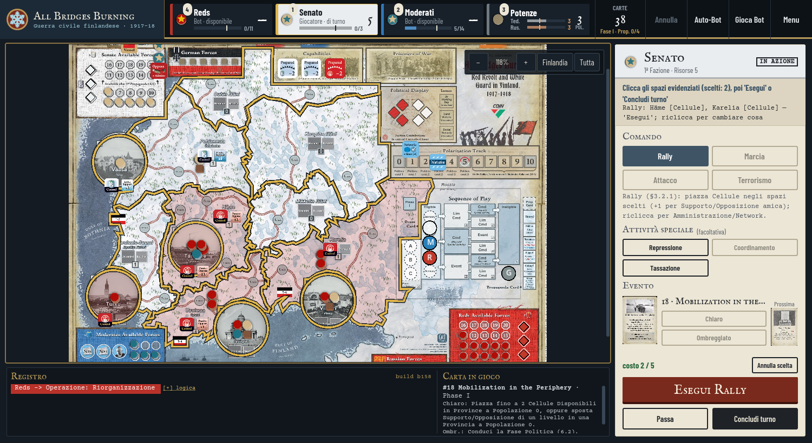

# COIN Engine (Godot 4)

Motore generico per la **serie COIN** di GMT Games + modulo **Cuba Libre**.
Progetto Godot 4.3.

## Architettura

```
coin_engine/        MOTORE COIN GENERICO (riusabile per altri giochi COIN)
  CoinEnums.gd        enumerazioni comuni
  PieceTypeDef.gd     definizione tipo di pezzo (cube/guerriglia/base, stati)
  FactionDef.gd       definizione Fazione
  SpaceDef.gd         definizione spazio mappa
  GameDef.gd          definizione completa del gioco (immutabile)
  SpaceState.gd       stato mutabile di uno spazio (pezzi, supporto, controllo, marker)
  GameState.gd        stato mutabile della partita (+ Controllo, Supporto/Opposizione)
  RulesModule.gd      interfaccia che ogni gioco COIN implementa

games/
  cuba_libre/
    CubaLibreModule.gd   modulo concreto: dati, tipi di pezzo, setup, vittoria
    data/                spaces / factions / setup / cards (JSON)

tests/
  test_runner.gd      test headless (validano dati, setup, controllo, vittoria)

scenes/               interfaccia grafica (fase successiva)
```

Il principio è la separazione tra **motore generico** (meccaniche comuni a tutti i COIN:
spazi, fazioni, pezzi con stati, Controllo, Supporto/Opposizione, sequenza a carte,
round periodici, framework di vittoria) e **modulo di gioco** (dati e regole specifiche).
Per implementare un altro gioco COIN basta aggiungere `games/<gioco>/` con il suo
`RulesModule` e i dati.

## Eseguire i test (headless)

```bash
# prima importazione del progetto (genera la cache delle classi globali)
godot4 --headless --path godot --import

# esecuzione dei test
godot4 --headless --path godot -s res://tests/test_runner.gd
```

Esce con codice 0 se tutti i test passano.

## Aprire nell'editor

Aprire la cartella `godot/` come progetto in Godot 4.3+.

## Interfaccia di partita (schema COIN)



La scena `scenes/Main.tscn` segue lo schema comune ai giochi COIN (lo stesso di Cuba Libre):

| Zona | File | Contenuto |
| --- | --- | --- |
| Barra superiore | `scenes/TopBar.gd` | Emblema e titolo; una tessera per Fazione giocabile (segnalino, ordine sulla carta, Giocatore/Bot · stato, Risorse, barra della Vittoria con tacca della soglia — clic = cambia ruolo); tessera **Potenze** (Vassallaggio tedesco/russo con la tacca oltre cui Vass.+Pol. > 5 azzera la vittoria, Polarizzazione); carte rimaste, Fase I/II e Propaganda; tasti Annulla, Auto-Bot, Gioca Bot, Menu (Bot, velocità, Coordinamento tedesco §4.2.4, nuova partita). |
| Mappa | `scenes/Main.gd` | Cornice d'ottone, zoom (−, %, +), vista **Finlandia** (inquadra gli spazi) e **Tutta** (plancia intera con tracciati, Political Display, Sequenza di gioco). |
| Striscia in basso | `scenes/BottomStrip.gd`, `scenes/LogView.gd` | Registro (righe colorate per Fazione, logica dei Bot espandibile, numero di build) e riquadro «Carta in gioco» con il testo italiano della carta. |
| Pannello azione | `scenes/Main.gd` (`_build_action_panel`) | Intestazione nel colore della Fazione di turno (timbro IN AZIONE/BOT), istruzioni, **Comando** (2 colonne; la descrizione compare solo quando è scelto), **Attività speciale** (un tasto per attività e per variante, es. Relazioni Estere Germania/Russia ±1), **Evento** (carta corrente e prossima, Chiaro/Ombreggiato; clic = ingrandisci), costo previsto, tasto **Esegui** contestuale, Passa e Concludi turno. |

Regola di turno (in `GameController`: `op_block_reason`, `special_block_reason`,
`abb_operation`, `abb_special`, `abb_preview`): **un solo Comando** per turno (si può
riprendere in spazi nuovi, mai due volte nello stesso spazio) e **una sola Attività
speciale**; dopo aver agito niente Passa né Evento; «Gioca Bot» disabilitato a metà turno.
Test: `_test_abb_one_command_per_turn` in `tests/test_runner.gd`.

Aspetto: **tutto in `scenes/CoinTheme.gd`** (tema «dispaccio di stato maggiore, inverno
finlandese 1918»): palette, caratteri, riquadri, nomi brevi e colori delle Fazioni,
emblema e titolo. Per un altro gioco COIN basta sostituire quel file. Caratteri (OFL, in
`assets/fonts/` con le licenze): IM Fell English SC (titoli), Courier Prime (istruzioni e
registro), Barlow Condensed (interfaccia).

### Screenshot (headless)

```bash
xvfb-run -a -s "-screen 0 1600x950x24" godot --path godot --rendering-method gl_compatibility \
    --resolution 1500x820 -s res://tools/screenshot.gd -- out.png [modo]
```

Modi: nessuno (turno del Senato umano), `rally` (Rally su due spazi), `eseguito` (Rally
eseguito + Tassazione preparata), `moderati` (Moderati umani), `fase2` (Fase II, Attacco dei Reds).
